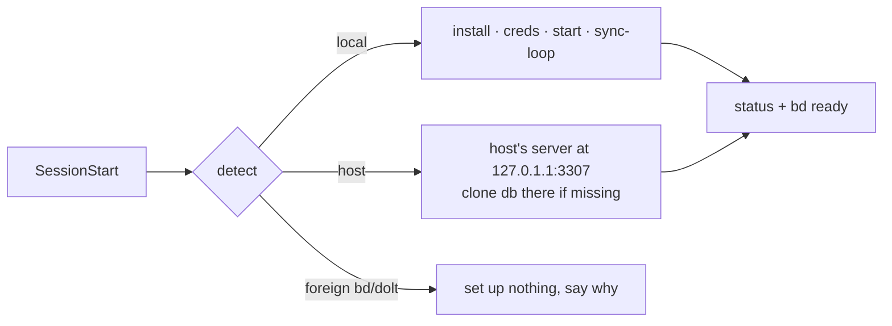

# Beads on DoltHub — how the task graph is stored and synced

Since 2026-11-28 the beads graph (prefix `kp`) lives in a private DoltHub
database. Each session runs bd 1.3.4 in **server mode**: on an ai-sandbox
host against the host's shared `dolt sql-server` (which ai-sandbox syncs),
anywhere else against a local one the session starts and syncs every
minute. The wiring is ai-sandbox's **repo kit** (`.claude/beads/`, written by
`ai-sandbox-beads-repo-kit`; its design is in ai-sandbox's
`modules/beads/README.md`, "The repo kit"). The previous
embedded/git-branch setup is archived in
`docs/archive/beads-dolt-git-remotes.md`; the migration record is
`ai/beads-dolthub-migration-handoff.md`.

## What lives where

| Item | Where | Tracked? |
|---|---|---|
| Issue data | DoltHub `<owner>/k8s-platform`; local copy on the ai-sandbox host's server, or in a cloud sandbox in `~/.beads-dolt/k8s-platform` | No (outside the repo) |
| Remote URL | `.beads/config.yaml` `sync.remote` | Yes |
| Database name, project ID, server mode | `.beads/metadata.json` (no host, port or user) | Yes |
| Last background sync | `.beads/sync-loop.status` (`<exit code> <epoch>`) | No |
| Pins | `.claude/beads/versions.env` (from ai-sandbox's `versions.toml`; refresh with the kit, never edit) | Yes |
| DoltHub key | env `DOLTHUB_CREDS_JWK` (cloud environment secret) → `dolt creds import` | Never |
| bd behaviour switches | `.claude/settings.json` `env`: `BEADS_DOLT_SERVER_MODE=1`, `BEADS_DOLT_AUTO_START=0`, `BD_NO_REMOTE_ADOPT=1` | Yes |

`BD_NO_REMOTE_ADOPT=1` is required: without it `bd sync` / `bd dolt push`
adopt the git origin (GitHub) as the Dolt remote when none is configured.

## Session lifecycle (`.claude/beads/beads.sh`)

- **detect** — `host` when `ai-sandbox-beads-status` is installed (an
  ai-sandbox host); otherwise `local`, unless `dolt` or a persistent `bd`
  that the script didn't start is running, in which case nothing is set up.
- **host** — never installs, starts or syncs anything. Fails loudly if the
  host's server is stopped on purpose (only the owner restarts it). If the
  server lacks the database, `ai-sandbox-beads-clone` fetches it from
  DoltHub (bootstrap, then `dolthub` as its only remote, under the host
  sync's lock). Also sets `.beads` to 0700 and `git config beads.role
  maintainer` in the clone.
- **install** (cloud sessions only) — `npm install -g @beads/bd@$BD_VERSION`;
  dolt from the GitHub release tarball, refused unless its SHA-256 matches.
- **creds** — dolt `user.name`/`user.email` from git config,
  `metrics.disabled`, then imports the key (`DOLTHUB_CREDS_JWK`) from stdin
  unless `dolt creds check` already passes. Never prints it.
- **start** — `dolt sql-server --data-dir ~/.beads-dolt` on 127.0.0.1:3307
  (launched directly so `$!` is the server). If the database directory is
  missing, **`bd bootstrap --yes`** clones it from `sync.remote`.
- **sync-loop** — PID-guarded background loop: `bd sync` every 60 s,
  result to `.beads/sync-loop.status`. Exit codes: 0 synced, 1 error,
  2 merge conflict (nothing pushed), 3 transient, 4 stuck working set.
  Never auto-resolves.
- **status** — the per-prompt line. Host: `host-sync ok <age>`, or
  STOPPED ON PURPOSE. Cloud: flags codes 1/2/4, a sync older than 3 min, a
  bd that is not the pin, or no server/key (`UNAVAILABLE`).
- **prepush-hook** — before a `git push` in a cloud sandbox, one `bd sync`;
  blocks the push on 1/2/4. Does nothing on a host (the host syncs).

Switching between the host and a cloud sandbox: one place writes at a
time; before switching, the last sync must be newer than the last write.

Loss window: up to one minute of beads writes if the container is
reclaimed between syncs and no `git push` happened.

## Rules learned in the migration

- **Clone with `bd bootstrap`, never `dolt clone`.** bd's machine-local
  tables (`leases`, `events`, `wisps`, `local_metadata`, `repo_mtimes`,
  `bd_events_*`, `ignored_schema_migrations`) are in `dolt_ignore`, so a
  plain dolt clone lacks them and every bd command fails with
  `table not found: leases`. `bd bootstrap` creates them.
- **Events don't travel.** A fresh clone's `events` table is empty (#7039,
  schema migration 0062). Never run `bd compact` or `bd flatten`.
- **Push/pull run inside the server** (`CALL DOLT_PUSH/PULL`), so the
  server process's dolt credentials (`~/.dolt`) are the ones used.
- An empty DoltHub database cannot be cloned ("contains no Dolt data"):
  the first push must come from a database created locally.
