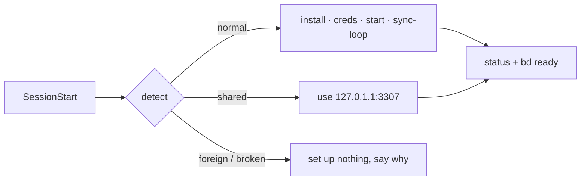

# Beads on DoltHub — how the task graph is stored and synced

Since 2026-11-28 the beads graph (prefix `kp`) lives in a private DoltHub
database. Each session runs bd 1.3.4 in **server mode** against a local
`dolt sql-server` and syncs with DoltHub every minute. The previous
embedded/git-branch setup is archived in
`docs/archive/beads-dolt-git-remotes.md`; the migration record is
`ai/beads-dolthub-migration-handoff.md`.

## What lives where

| Item | Where | Tracked? |
|---|---|---|
| Issue data | DoltHub `<owner>/k8s-platform`; local copy in `/home/user/.beads-dolt/k8s-platform` | No (data dir is outside the repo) |
| Remote URL | `.beads/config.yaml` `sync.remote` | Yes |
| Database name, project ID, server mode | `.beads/metadata.json` (no host, port or user) | Yes |
| Port | `.beads/dolt-server.port` (`3307`), written at start | No |
| Last background sync | `.beads/sync-loop.status` (`<exit code> <epoch>`) | No |
| Pins | `versions.env`: `BD_VERSION`, `DOLT_VERSION`, `DOLT_SHA256` | Yes |
| DoltHub key | env `DOLTHUB_CREDS_JWK` (cloud environment secret) → `dolt creds import` | Never |
| bd behaviour switches | `.claude/settings.json` `env`: `BEADS_DOLT_SERVER_MODE=1`, `BEADS_DOLT_AUTO_START=0`, `BD_NO_REMOTE_ADOPT=1` | Yes |

`BD_NO_REMOTE_ADOPT=1` is required: without it `bd sync` / `bd dolt push`
adopt the git origin (GitHub) as the Dolt remote when none is configured.

## Session lifecycle (`scripts/beads-server.sh`)

- **detect** — decision table in `ai/beads-dolthub-migration-handoff.md`
  §5.2. In short: with no `~/.local/state/ai-sandbox` marker and no foreign
  `dolt`/persistent `bd` process it is the normal path; with the marker it
  uses the shared server at **127.0.1.1**:3307 if it answers and
  `beads-sync.state` has no `beads-sync-HALTED`, and clones the database
  into it with `bd bootstrap` if it is not there yet (the database is part
  of this repo; a clone error, e.g. no DoltHub key on that server, fails
  setup loudly); anything else sets up nothing and exits non-zero. Processes in the script's own PID files (and
  their children) are not foreign.
- **install** (cloud sessions only) — `npm install -g @beads/bd@$BD_VERSION`;
  dolt from the GitHub release tarball, refused unless its SHA-256 matches.
- **creds** — dolt `user.name`/`user.email` from git config,
  `metrics.disabled`, then imports the key from stdin unless
  `dolt creds check` already passes. Never prints the variable.
- **start** — `dolt sql-server --data-dir /home/user/.beads-dolt` on
  127.0.0.1:3307 (PID in `server.pid`, launched directly so `$!` is the
  server). If the database directory is missing, **`bd bootstrap --yes`**
  clones it from `sync.remote` through the server.
- **sync-loop** — PID-guarded background loop: `bd sync` every 60 s,
  result to `.beads/sync-loop.status`. Exit codes: 0 synced, 1 error,
  2 merge conflict (nothing pushed), 3 transient, 4 stuck working set.
  Never auto-resolves.
- **status** — the per-prompt line; flags codes 1/2/4, a sync older than
  3 min, a bd that is not the pin, or no server/key (`UNAVAILABLE`).
- **sync-now** — one `bd sync`; the pre-`git push` hook runs it and blocks
  the push on 1/2/4.

Loss window: up to one minute of beads writes if the container is
reclaimed between syncs and no `git push` happened.

## Rules learned in the migration

- **Clone with `bd bootstrap`, never `dolt clone`.** bd's machine-local
  tables (`leases`, `events`, `wisps`, `local_metadata`, `repo_mtimes`,
  `bd_events_*`, `ignored_schema_migrations`) are in `dolt_ignore`, so a
  plain dolt clone lacks them and every bd command fails with
  `table not found: leases`. `bd bootstrap` creates them.
- **Events don't travel.** A fresh clone's `events` table is empty (#7039,
  schema migration 0062). Never run `bd compact` or `bd flatten`.
- **Push/pull run inside the server** (`CALL DOLT_PUSH/PULL`), so the
  server process's dolt credentials (`~/.dolt`) are the ones used.
- An empty DoltHub database cannot be cloned ("contains no Dolt data"):
  the first push must come from a database created locally.
