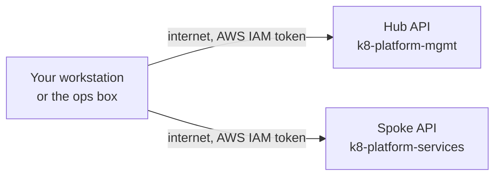
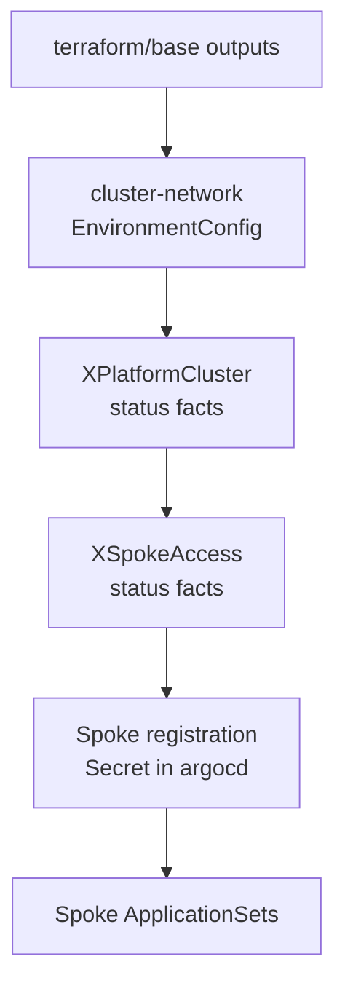

# Get admin access and the platform facts

You are the platform's administrator. This page gets you four things:
a `kubectl` that works against both clusters, the Argo CD URL and admin
password, your own directory login, and the account-specific values the
platform discovered for itself — the domain, the certificate ARN, the
role ARNs, the API endpoints. It documents the design as it stands,
gaps included.

!!! warning "Mostly verified mechanisms; these instructions not executed by a person"
    Most mechanisms below have run on a clean build — as a workflow
    step, or from an agent session inside the sandbox. Three scripts
    have not: `scripts/k8p-kubeconfig.sh`, `scripts/k8p-cognito-user.sh`
    and `scripts/k8p-argocd-password.sh`, and neither has the Argo CD
    password's home in AWS Secrets Manager. Each is marked
    **unverified** where it appears. **Nobody has worked through this
    page as written.** Where a command has an attested form somewhere
    in this repository, this page names where; where it does not, it
    says so instead of guessing.

    A person executing this page end to end on a fresh build is what
    flips it to `stable`.

If you got here from
[Build the platform from nothing](build-the-platform-from-nothing.md),
this is the page that closes its open item: how a human obtains the
Argo CD credentials.

## The three surfaces

| Surface | What it is | How you authenticate |
|---|---|---|
| Management cluster API (`k8-platform-mgmt`) | The hub: Argo CD, Crossplane, the composite resources | AWS IAM |
| Platform services cluster API (`k8-platform-services`) | The spoke: ingress, DNS, SSO components, workloads | AWS IAM (read-only) **or** your directory group (admin) |
| Argo CD UI and API (`argocd.management.<domain>`) | The delivery surface | A local `admin` account whose password lives in AWS Secrets Manager, `k8-platform/management/argocd-admin` (authoritative) |

They are independent. Losing one does not lose the others, and the
Argo CD credential is not derived from your cluster access.

---

## 1. Cluster access

### How you reach the clusters

Both cluster APIs are **public endpoints, by design**. You reach them
over the internet from wherever you are — your workstation or the ops
box — and AWS IAM decides who gets in. No private network path is
assumed or planned; that is an owner ruling (2026-11-27) recorded in
the roadmap: "The cluster API endpoints are public by design; an admin
reaches both clusters from anywhere with AWS credentials."



Where that is set: the hub has `cluster_endpoint_public_access = true`
(`terraform/management/eks.tf`), and the spoke's composition sets
`endpointPublicAccess: true` alongside `endpointPrivateAccess: true`
(`crossplane/compositions/platform-cluster.yaml`). Neither restricts
the source address range, so any address can reach either endpoint.
What keeps a stranger out is authentication: EKS accepts only an AWS
IAM token, and an IAM principal gets Kubernetes permissions only
through an access entry (the table below). The Terraform carries a note,
"Restrict to operator IP ranges in production environments". Narrowing
the source range would be hardening; that is an owner decision for the
step 6 security review, not something this page asks you to do.

### Getting a kubeconfig

One script writes a `kubectl` context for every platform cluster and
checks that each API answers:

```bash
scripts/k8p-kubeconfig.sh      # from a checkout, with AWS credentials for the account
k8p-kubeconfig.sh              # on the ops box (it is on PATH)
```

It finds the platform's clusters in the current account and region
(`-r <region>` to choose), writes a context named after each cluster
(`k8-platform-mgmt`, `k8-platform-services`), then runs four read-only
checks per cluster: the API's `/readyz`, `get nodes`, `auth can-i` and
`auth whoami`. It ends in a `RESULT: PASS` or `RESULT: FAIL` line and
exits non-zero when a cluster's API or nodes cannot be read. It writes
only kubeconfig entries and never prints tokens. Its output, including
why the `can-i` answers differ by cluster, is described in
[Connect kubectl to the clusters](build-the-platform-from-nothing.md#connect-kubectl-to-the-clusters).

*Unverified:* the script has run only against stubbed `aws` and
`kubectl` (`tests/unit/test_k8p_kubeconfig.sh`), not against a live
build.

Underneath, each context is the ordinary AWS CLI command, which you can
also run by hand for one cluster, without the checks:

```bash
aws eks update-kubeconfig --name k8-platform-mgmt      --region <region>
aws eks update-kubeconfig --name k8-platform-services  --region <region>
```

The hub form is the one the supported build path has used on every
clean build, and the management Terraform runs the identical command
inside its own provisioner when it applies the Argo CD password
(`terraform/management/argocd-credentials.tf`).

### What your AWS identity is allowed to do

| Cluster | IAM principal | Access | Where it is granted |
|---|---|---|---|
| Hub | The identity that applied `terraform/management` | Cluster admin | `enable_cluster_creator_admin_permissions = true` in `terraform/management/eks.tf` |
| Hub | The ops box's role, `k8-platform-opsbox` | Cluster admin | The box grants it to itself on first use by `k8p-bringup.sh` or `k8p-status.sh` (`scripts/opsbox/lib.sh`) |
| Spoke | `cloud_user` in the same account | **Read-only** (`AmazonEKSAdminViewPolicy`) | The `sandbox-access-entry` / `sandbox-access-policy` resources in `crossplane/compositions/platform-cluster.yaml` |
| Spoke | The ops box's role, `k8-platform-opsbox` | **Read-only** (`AmazonEKSAdminViewPolicy`) | `k8p-bringup.sh` grants it right after gate 1 |
| Spoke | The hub's `…-argocd` role | Cluster admin | The `access-entry` / `access-policy-association` resources in `crossplane/compositions/xspokeaccess.yaml` |

Two consequences worth stating plainly:

- On the hub you are an admin **because you created the cluster**, or
  because you are working on the ops box. If the platform was built
  with different credentials than yours, the creator's admin access
  entry belongs to those credentials, not to you.
- On the spoke, AWS IAM gives a human **read-only and nothing more**.
  The composition creates exactly one human-principal access entry,
  hard-coded to `arn:aws:iam::<account>:user/cloud_user`, with the
  read-only policy; the ops box gets the same policy. **Gap:** there is
  no committed mechanism that grants a named human AWS-IAM admin on a
  spoke.

To act as an admin on the spoke, use your directory login instead
(section 4): an account in `k8s-admins`, used through
[Get kubectl access via your directory group](kubectl-access-via-directory-group.md).
That path is the spoke's admin path by design — see
[Identity mapping](../reference/identity-mapping.md), which records the
hub as deliberately excluded from it ("operator break-glass via AWS IAM
only").

### The SSM relay is not your path

You may find `scripts/sandbox-kubeconfig.sh` and the `kube-relay` EC2
instance and wonder whether you should be using them. You should not.
That relay exists because the **agent sandbox** cannot speak to an EKS
API server at all: the sandbox's egress gateway verifies upstream
certificates against public roots, and the EKS API always presents a
certificate signed by the cluster's private CA, so a direct `kubectl`
from the sandbox is rejected before it reaches the cluster. The relay
tunnels raw TCP over an AWS Systems Manager session, whose own
certificate is publicly trusted, so `kubectl` still verifies the real
cluster CA end to end.

That is a build-and-debug capability for agents working *on* the
platform, scoped that way explicitly in ADR-0008 ("not part of the
platform's runtime"). From your workstation or the ops box, the public
endpoints and `k8p-kubeconfig.sh` above are the path; the relay adds
nothing.

---

## 2. The Argo CD URL and password

### Where they live

| What | Where | Notes |
|---|---|---|
| URL | `https://argocd.management.<domain>` | Also the `terraform/management` output `argocd_server_url` (and `argocd_url`, an older name for the same string) |
| Password for user `admin` | AWS Secrets Manager secret `k8-platform/management/argocd-admin`, its current (`AWSCURRENT`) version | **Authoritative.** The output `argocd_admin_secret_name` names it |
| Output `argocd_admin_password` | A mirror of that secret as of the last Terraform plan or refresh | Stale after any change made with the script; do not rely on it |

How the password gets there, and into Argo CD:

1. On a fresh account, Terraform generates a 24-character alphanumeric
   value (`random_password`) and writes it as the secret's first
   version. It does that **once**: the secret version ignores later
   changes, so a re-apply never puts the seed back.
2. A Terraform provisioner reads the secret's current value, bcrypts it,
   patches the hash into the `argocd-secret` Secret's `admin.password`
   field, and restarts the Argo CD server so it takes effect
   (`terraform/management/argocd-credentials.tf`).
3. After that, the password changes only through
   `scripts/k8p-argocd-password.sh set` (below), which applies a change
   with the same bcrypt-and-patch mechanism.

**Do not read `argocd-initial-admin-secret`.** That Secret holds the
password Argo CD generated for itself at install time; the patch above
replaces the stored hash afterwards, so the initial-admin value no
longer opens the account. The repository states the rule directly in
`ai/environment.md`: "Never depend on `argocd-initial-admin-secret`".

### Read the password

```bash
scripts/k8p-argocd-password.sh show            # describes the secret; prints no password
scripts/k8p-argocd-password.sh show --reveal   # also prints the password
scripts/k8p-argocd-password.sh check           # does the stored value log in to Argo CD right now?
```

Run it from the repository checkout — on the ops box you land in one —
or from your own checkout with AWS credentials for the account. With
only the AWS CLI, read the secret directly:

```bash
aws secretsmanager get-secret-value \
  --secret-id k8-platform/management/argocd-admin \
  --query SecretString --output text
```

Then sign in at the URL as user `admin` with that password.

If `check` reports that the stored value does not log in, Secrets
Manager and Argo CD disagree. The script prints the command that
re-applies the stored value: a targeted `terraform apply -replace` of
the provisioner above.

### Change the password

```bash
scripts/k8p-argocd-password.sh set              # asks twice without echo, or reads one line of stdin
scripts/k8p-argocd-password.sh set --generate   # makes one up and prints it once
```

`set` writes the new value as a new secret version (the old one stays
as `AWSPREVIOUS`, which is the rollback), applies it to Argo CD, and
verifies it by logging in. If applying or verifying fails, it moves the
secret back to the old version, re-applies the old password, and says
so loudly. The password never appears on a process command line. It
needs `aws`, `kubectl`, `htpasswd`, `jq` and `curl`, write access to the
secret, and admin on the hub; the ops box has all of these.

### What is attested, and what is not

- **Attested:** the bcrypt-and-patch mechanism, which has applied the
  Argo CD password on every clean build, and the hub
  `aws eks update-kubeconfig` it runs first.
- **Unverified:** the Secrets Manager secret, the provisioner reading
  its value from there, and the script. They have run only in unit
  tests with stubbed tools
  (`tests/unit/test_argocd_admin_password_source.sh`,
  `tests/unit/test_argocd_password_script.sh`); no build and no person
  has run them yet: `pending clean-build verification`.

### Reading other Terraform outputs

You do not need Terraform state for the password, but the hub facts in
section 3 are `terraform/management` outputs. Reading one needs:

| You need | Why |
|---|---|
| A checkout of this repository | `terraform output` reads the module directory's initialized state |
| `terraform` ≥ 1.6 | `required_version` in `terraform/management/versions.tf` |
| AWS credentials for the account | To read the state object and take the state lock |
| The state backend coordinates: bucket, key, region, lock table | The `backend "s3"` block is deliberately empty — it is configured by flags, not committed |

For a platform built by the supported CI path, the backend values are
derived, not chosen. The workflow computes them from the account ID
(`.github/workflows/terraform-test.yml`):

| Backend setting | Value |
|---|---|
| `bucket` | `k8-platform-tfstate-<account-id>` |
| `key` | `k8-platform/management/terraform.tfstate` |
| `region` | The build region (`us-east-1` by default) |
| `dynamodb_table` | `k8-platform-tfstate-lock` |

(If you built from a workstation instead, you named the bucket, key and
lock table yourself — use the values you passed to `terraform init`
then.)

```bash
cd terraform/management
terraform init \
  -backend-config="bucket=k8-platform-tfstate-<account-id>" \
  -backend-config="key=k8-platform/management/terraform.tfstate" \
  -backend-config="region=<region>" \
  -backend-config="dynamodb_table=k8-platform-tfstate-lock"

terraform output -raw argocd_server_url
```

- **Attested:** `terraform init` with exactly those four
  `-backend-config` flags, and `terraform output -raw <name>` run from
  `terraform/management`, both run on every clean build inside
  `.github/workflows/terraform-test.yml` — the management verify step
  reads the URL that way.
- **Not attested:** nobody has run them from a workstation. The
  `terraform -chdir=terraform/management output -raw …` variant in
  `terraform/management/outputs.tf`'s comments is a documented
  alternative, not one this page has seen executed.

### What is missing here

- **Argo CD has no SSO.** There is no `oidc.config` or Dex
  configuration anywhere in the deployed Argo CD values, so the local
  `admin` account is the only way in.
  [Log into platform UIs with SSO](log-into-platform-uis-with-sso.md)
  already lists Argo CD as planned rather than shipped; this is the
  same gap seen from the admin side.
- **The certificate on that hostname is not asserted by the build.**
  The management verify step confirms the DNS record exists and that
  the URL answers, but it makes that request with certificate
  verification disabled. Treat "Argo CD answers" as verified and
  "Argo CD answers over a valid public certificate" as unverified by
  that check.

---

## 3. The platform facts

### Why there is nothing to configure

Every account-specific value in this platform is **discovered and
published**, never hand-entered: the domain comes from whatever public
hosted zone the account has, the ARNs come from the resources
Crossplane just created, the endpoint and CA data come from the cluster
itself. No manifest in `clusters/` or `crossplane/` carries an account
ID, an ARN, or a domain. This is the rule the repository states as
"every account-specific value flows through discovery — never through
commits or hand-edits", and ADR-0010 is the decision that carries it
across the hub/spoke boundary.



### Where each fact is produced, and where you read it

| Fact | Produced by | Read it live with |
|---|---|---|
| `domain` | Base Terraform → the `cluster-network` EnvironmentConfig | `kubectl get environmentconfig cluster-network -o yaml` (hub) |
| `subdomain`, `region` | The `XSpokeAccess` XR's own spec | `kubectl -n platform get xspokeaccess platform -o yaml` |
| `certificate-arn` | `XPlatformCluster` → `status.certificateArn` | `kubectl -n platform get xplatformcluster platform -o yaml` |
| `external-dns-role-arn`, `eso-role-arn` | `XSpokeAccess` composed IAM roles → its status | `kubectl -n platform get xspokeaccess platform -o yaml` |
| Cluster `endpoint`, `oidcIssuer`, `clusterCaData` | `XPlatformCluster` status, observed by `XSpokeAccess` | `kubectl -n platform get xplatformcluster platform -o yaml` |
| Hub cluster name, endpoint, CA data, OIDC provider ARN | `terraform/management` outputs | `terraform output` (see section 2 for the backend flags) |

The `cluster-network` EnvironmentConfig also carries the account ID,
the VPC id and CIDR, the private subnet IDs, the Route53 zone id, the
hub Argo CD role ARN, and the relay security-group id — all written by
`terraform/management/crossplane-phase3.tf` from base's outputs. It is
the single place to look when you want to know what the platform thinks
the account looks like.

Every command in that table needs hub cluster access. **Gap:** there is
no read-only facts surface — no page, endpoint, or ConfigMap — for
someone who is not a hub admin.

### The registration Secret contract

The spoke's facts travel to the add-ons on one object: the spoke's
Argo CD **cluster Secret** on the hub. It is Argo CD's connection
credential and the platform's fact bus at the same time, written by one
writer — a `provider-kubernetes` `Object` composed by the
`xspokeaccess-aws` composition.

| Part of the contract | Value |
|---|---|
| Namespace | `argocd` (on the hub) |
| Name | `<subdomain>-spoke` — `platform-spoke` for the platform services cluster |
| Label | `argocd.argoproj.io/secret-type: cluster` — without it Argo CD does not treat the Secret as a cluster |
| Label | `k8-platform.io/cluster-role: spoke` — what the add-on ApplicationSets select on |
| Label | `k8-platform.io/short-name` — names the generated Applications and picks per-cluster values files |
| Annotations | `k8-platform.io/domain`, `subdomain`, `region`, `certificate-arn`, `external-dns-role-arn`, `eso-role-arn` |
| Data | `name`, `server` (the spoke API endpoint), `config` (the spoke cluster name plus its CA data) |

Read it with:

```bash
kubectl -n argocd get secret -l argocd.argoproj.io/secret-type=cluster,k8-platform.io/cluster-role=spoke
kubectl -n argocd get secret platform-spoke -o jsonpath='{.metadata.annotations}'
```

**Complete or absent.** Every value patched into that Secret is marked
required, which means the composition function will not create the
Secret at all until every fact resolves. A partially populated
registration Secret is therefore not a state the platform passes
through on its way to being ready — it is a defect to report. The rule
is stated in ADR-0010 and enforced in both directions by a unit test
that checks the composition emits exactly the contract keys and that no
consumer references a key outside it, so a Secret and an add-on cannot
drift apart silently.

The consumers are ApplicationSets that template these annotations
directly, and they are configured to fail generation on a missing key
rather than render an empty value. That is why a missing fact shows up
as a loud generation error, not as an add-on quietly deployed with a
blank certificate ARN.

---

## 4. Directory accounts: your own, and end users'

The directory path this platform documents — sign in with a directory
account, land in a Kubernetes group, use `kubectl` through OIDC — needs
an account to exist. **Nothing in a build creates one.** The federation
oracle creates an ephemeral fixture user, proves the whole chain with it,
and its reaper deletes it again, so after a fresh build neither you nor
a person following
[kubectl via directory group](kubectl-access-via-directory-group.md)
has anything to sign in with until you create it.

Creating accounts is an **admin action**, not self-service; a
self-service onboarding flow is a v2.0 item. One script does it, using
your AWS credentials:

```bash
scripts/k8p-cognito-user.sh add <email> [--group k8s-admins|k8s-viewers]
scripts/k8p-cognito-user.sh list
scripts/k8p-cognito-user.sh remove <email>
```

On the ops box it is on PATH as `k8p-cognito-user.sh`, and the box's
role has the Cognito permissions it needs. From your own checkout, any
AWS credentials with Cognito admin rights on the pool work.

What `add` does:

- **Finds the user pool itself.** It is not hardcoded anywhere: the
  script reads it from the Cognito bridge document the base build
  writes to Secrets Manager (`k8-platform/base/cognito`).
- **Creates the account with a permanent password**, then puts it in
  the group. The default group is `k8s-admins`.
- **Takes the password without exposing it.** By default it asks twice
  without echo; `--password-stdin` reads the first line of stdin;
  `--generate` makes one up and prints it exactly once. The password is
  never on a command line, so it is not in your shell history or in
  `ps`.
- **Is safe to re-run.** For an account that already exists it only
  makes sure of the group membership, and changes the password only
  with `--reset-password`.
- **Verifies.** After every change it reads the account back and
  prints its status and groups; any AWS failure exits non-zero with the
  AWS error's last line.

### Your own directory login

Make your own account first, in `k8s-admins` (the default):

```bash
scripts/k8p-cognito-user.sh add you@example.com
```

Then follow
[kubectl via directory group](kubectl-access-via-directory-group.md).
What that login reaches:

| Surface | Does your directory login reach it? | Why |
|---|---|---|
| Platform services cluster (spoke) | **Yes**, as cluster admin | `k8s-admins` becomes `kc:k8s-admins` in the cluster, bound to `cluster-admin` ([Identity mapping](../reference/identity-mapping.md)) |
| Management cluster (hub) | **No** | By design the hub is reached through AWS IAM only (section 1) |
| Argo CD | **No** | Argo CD has no SSO; use the local `admin` account (section 2) |

### An account for an end user

Users who ask the platform operator for access get one the same way.
Pick `k8s-viewers` unless the person needs to change things:

```bash
scripts/k8p-cognito-user.sh add person@example.com --group k8s-viewers
```

Then hand the person their email, the initial password, and the
[kubectl via directory group](kubectl-access-via-directory-group.md)
page. To take access away, `remove` the account.

!!! warning "What is attested here, and what is not"
    The four AWS calls the script makes (find the pool, create the
    user, set a permanent password, add to the group) are the ones
    `tests/live/checks/instantiate/cognito-federation-live.sh` runs on
    every build with `LIVE_PROFILE=full`, against the same pool and the
    same groups, and the full chain — Cognito account → Keycloak broker
    → federated `kubectl` — passed on clean builds #6 and #7.

    *Unverified:* the script itself has run only against stubbed tools
    (`tests/unit/test_k8p_cognito_user.sh`); nobody has run it against a
    live build. Because the password is permanent, the user is never
    prompted to change it; treat it as one to rotate
    (`add <email> --reset-password`).

## Gaps this page names

| Gap | Consequence |
|---|---|
| Both API endpoints are public with no source address restriction | By design: AWS IAM authentication and access entries are the control. Narrowing the source range is hardening, an owner decision for step 6 |
| No AWS-IAM admin access entry for a named human on the spoke | Spoke admin is only reachable through the directory group, or through the hub's Argo CD role |
| Hub admin belongs to whichever identity applied the Terraform (plus the ops box's role) | If the platform was built with other credentials, your own may not be an admin there |
| Argo CD has no SSO | The shared local `admin` account is the only login |
| Argo CD browser sign-in has never been exercised | Every attestation is via the `argocd` CLI or `kubectl`; the browser experience is unverified (`kp-2al.29`) |
| No build creates a durable directory account | Section 4 is the admin doing it by hand on request; a composed or self-service account is a v2.0 item (`kp-2al.29`) |
| Changing the Argo CD password is scripted but unverified | `k8p-argocd-password.sh set [--generate]` exists and is unit-tested; no build or person has run it |
| The three admin scripts have not run against a live build | `k8p-kubeconfig.sh`, `k8p-cognito-user.sh` and `k8p-argocd-password.sh` are unit-tested against stubs only |
| The Argo CD URL's certificate is not verified by the build | "Reachable" is attested; "valid public certificate" is not |
| Facts are readable only by a hub admin | No read-only surface for anyone else |
| No person has executed this page | Its marker stays `contract` until someone does |

---

*Tracking: beads `kp-2al.6` (this page) and `kp-2al.39` (public
endpoints, the admin's own directory login, the scripts). Decisions
referenced: ADR-0008 (the SSM relay is implementation-time only),
ADR-0010 (cluster facts ride the registration Secret), ADR-0017
(platform bring-up and administration are user-facing surfaces).*
